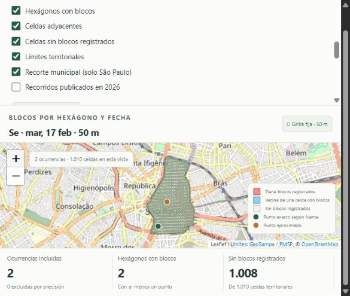

# Atlas de blocos de rua de São Paulo

¿Cuándo y dónde se programaron los desfiles del carnaval de calle de São Paulo? Esta base reúne **4.109 registros** de siete ediciones: 2018, 2019, 2020, 2023, 2024, 2025 y 2026. Cada fila corresponde a una aparición de un bloco en una fuente. Un mismo bloco puede figurar en distintas fechas o ediciones.

**[Descargar la base en Excel](https://raw.githubusercontent.com/josebravof99/blocos-de-rua-datos/main/BlocosdeRuaData.xlsx)** · **[Descargar el CSV consolidado](https://raw.githubusercontent.com/josebravof99/blocos-de-rua-datos/main/datos/blocos.csv)** · **[Instalar el atlas](#instalar-el-atlas)**



## Qué contiene la base

El CSV reúne los siete años en una sola tabla de 28 columnas. En el Excel, la hoja **Consolidado** contiene los registros y **Fuentes** documenta su procedencia. Para seguir una corrección, busca el bloco y la fecha, consulta la referencia directa y lee la observación de esa fila.

| Ubicación disponible | Registros |
| --- | ---: |
| Punto exacto según la fuente | 1.078 |
| Aproximación por dirección, calle o recorrido | 2.835 |
| Centroide de barrio o subprefectura | 179 |
| Coordenada heredada sin método documentado | 17 |

El campo **Estado de verificación** indica qué se sabe sobre cada desfile. La cobertura depende de las fuentes disponibles. En particular, 2021 y 2022 quedan fuera de la serie. [Fuentes, correcciones y límites](LEEME_fuentes_y_formato.txt)

## Explorar el mapa

El atlas abre con una grilla de **50 metros** y permite filtrar por fecha, distrito, subprefectura, nombre y precisión de la coordenada. Al seleccionar un hexágono puedes consultar los blocos de esa celda y su relación con las seis celdas vecinas. La capa de 2026 añade **511 recorridos** vinculados a registros de ese año.

Para comparar lugares en una misma fecha, descarga el **panel por hexágono y día**. Puedes incluir las celdas con cero registros o limitar la descarga a las que contienen un bloco y sus vecinas. Diez puntos quedan fuera del límite municipal y se conservan en la base consolidada. [Guía del mapa y las exportaciones](aplicacion/LEEME.md)

## Instalar el atlas

Descarga y descomprime el [proyecto completo](https://github.com/josebravof99/blocos-de-rua-datos/archive/refs/heads/main.zip). Con Python 3.14, abre una terminal en la carpeta que contiene este README y ejecuta:

```sh
python -m pip install -r aplicacion/requirements.txt
python aplicacion/iniciar.py
```

El primer inicio descomprime la grilla incluida. El mapa se abre en tu navegador en [127.0.0.1:8765](http://127.0.0.1:8765). En Windows, después de instalar las dependencias, también puedes abrir **aplicacion/INICIAR.cmd**. El fondo de calles usa Internet; los puntos, hexágonos y límites administrativos se consultan en tu equipo.

