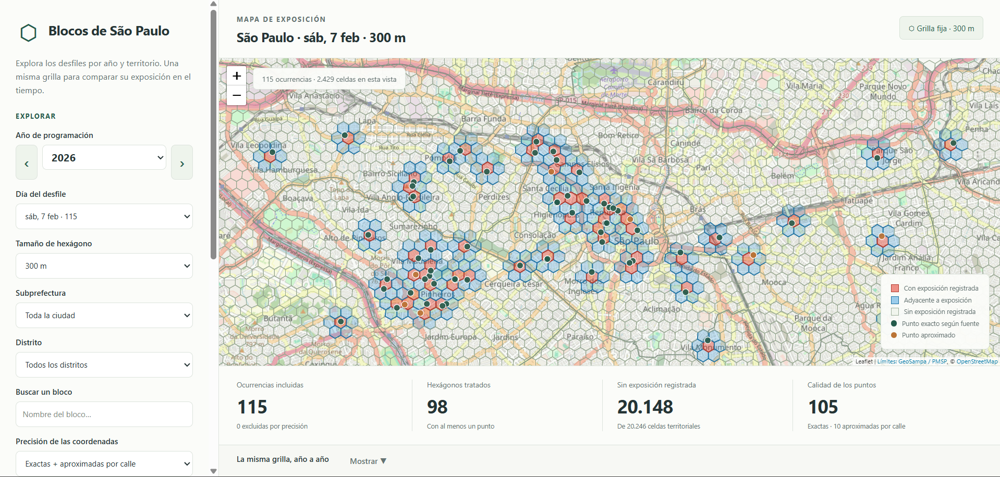

# Atlas de blocos de rua de São Paulo

¿Cuándo y dónde se programaron los desfiles del carnaval de calle de São Paulo? Esta base reúne **4.109 registros** de siete ediciones: 2018, 2019, 2020, 2023, 2024, 2025 y 2026. Cada fila corresponde a una aparición de un bloco en una fuente. Un mismo bloco puede figurar en distintas fechas o ediciones.

**[Descargar la base en Excel](https://raw.githubusercontent.com/josebravof99/blocos-de-rua-datos/main/BlocosdeRuaData.xlsx)** · **[Descargar el CSV consolidado](https://raw.githubusercontent.com/josebravof99/blocos-de-rua-datos/main/datos/blocos.csv)** · **[Instalar el atlas](#instalar-el-atlas)**

Para consultar los registros basta con abrir el Excel o importar el CSV en tu herramienta habitual. Puedes hacerlo sin instalar Python ni ejecutar la app. [Fuentes y permisos de los datos](docs/permisos-datos.md)

[](https://raw.githubusercontent.com/josebravof99/blocos-de-rua-datos/main/docs/atlas-sao-paulo.png)

[Ver la captura a tamaño completo · 1918 × 916 píxeles](https://raw.githubusercontent.com/josebravof99/blocos-de-rua-datos/main/docs/atlas-sao-paulo.png)

## Qué contiene la base

El CSV reúne los siete años en una sola tabla de 28 columnas. En el Excel, la hoja **Consolidado** contiene los registros y **Fuentes** documenta su procedencia. Para seguir una corrección, busca el bloco y la fecha, consulta la referencia directa y lee la observación de esa fila.

| Ubicación disponible | Registros |
| --- | ---: |
| Punto exacto según la fuente | 1.078 |
| Aproximación por dirección, calle o recorrido | 2.835 |
| Centroide de barrio o subprefectura | 179 |
| Coordenada heredada sin método documentado | 17 |

El campo **Estado de verificación** indica qué se sabe sobre cada desfile. La cobertura depende de las fuentes disponibles. En particular, 2021 y 2022 quedan fuera de la serie. [Fuentes, correcciones y límites](LEEME_fuentes_y_formato.txt)

## Explorar el mapa

El atlas abre con una grilla de **50 metros** y permite filtrar por fecha, distrito, subprefectura, nombre y precisión de la coordenada. Al seleccionar un hexágono puedes consultar los blocos de esa celda y su relación con las seis celdas vecinas. La capa de 2026 añade **511 recorridos** vinculados a registros de ese año.

Para comparar lugares en una misma fecha, descarga el **panel por hexágono y día**. Puedes incluir las celdas con cero registros o limitar la descarga a las que contienen un bloco y sus vecinas. Diez puntos quedan fuera del límite municipal y se conservan en la base consolidada. [Guía del mapa y las exportaciones](aplicacion/LEEME.md)

## Instalar el atlas

Descarga y descomprime el [proyecto completo](https://github.com/josebravof99/blocos-de-rua-datos/archive/refs/heads/main.zip). Abre una terminal en la carpeta del README. Los siguientes comandos crean un entorno virtual con Python 3.14 e instalan allí las dependencias.

**Windows (PowerShell)**

```powershell
py -3.14 -m venv .venv
.\.venv\Scripts\python.exe -m pip install -r aplicacion/requirements.txt
.\.venv\Scripts\python.exe aplicacion/iniciar.py
```

**macOS o Linux**

```sh
python3.14 -m venv .venv
.venv/bin/python -m pip install -r aplicacion/requirements.txt
.venv/bin/python aplicacion/iniciar.py
```

Para volver a abrir el atlas, repite el último comando. El primer inicio descomprime la grilla. El servidor escucha en la dirección local [127.0.0.1:8765](http://127.0.0.1:8765). Los puntos, las consultas y las exportaciones se procesan en tu equipo. Para dibujar el fondo de calles, el navegador solicita a OpenStreetMap los mosaicos de la zona visible. Las pruebas del proyecto comprueban funciones del atlas; está pendiente una auditoría de seguridad.

## Licencias y atribución

El **código original de la aplicación** se distribuye bajo MIT. Puedes usarlo, modificarlo y distribuirlo, incluso comercialmente, conservando los avisos de copyright y de licencia en las copias o partes sustanciales. Leaflet conserva su licencia BSD de dos cláusulas. [Licencia MIT del atlas](aplicacion/LICENSE) · [Licencia de Leaflet](aplicacion/web/vendor/LICENSE)

Para compartir registros, recorridos, mapas o capturas, consulta las condiciones de la fuente correspondiente. [Fuentes y permisos de la base de datos](docs/permisos-datos.md)
